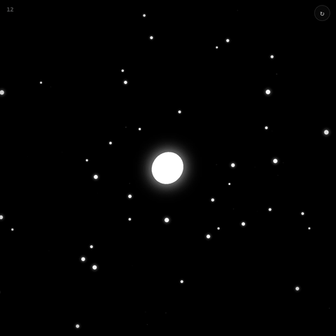

# mote

[English](README.md) · 한국어

**작은 빛 한 점으로 시작해 더 작은 것을 흡수하며 커지는 미니멀 아케이드 게임.**

**[▶ 브라우저에서 바로 플레이](https://tinkerer0.github.io/mote_game/)**



나보다 작은 먹이와 세포는 흡수하고 더 큰 세포는 피합니다. 커질수록 화면이 멀어지며 더 큰 세계가 나타나고, 일정 크기마다 세계의 색이 바뀝니다. 지금 크기를 코인으로 바꿔 다시 시작하고, 코인으로 주인공·먹이·배경 스킨을 모읍니다.

마우스·터치 또는 방향키(WASD)로 움직입니다. Enter는 지금 크기를 코인으로 바꾸기, M은 배경음, R은 게임 오버 뒤 다시 시작입니다.

## 직접 실행

빌드도 외부 라이브러리도 없는 HTML 파일 하나입니다.

```sh
git clone https://github.com/tinkerer0/mote_game.git
cd mote_game
python3 -m http.server 8000   # http://localhost:8000 열기
```

코인과 스킨은 이 브라우저(`localStorage`)에만 저장됩니다.

## Feedback

제가 이런 분야를 접한 지 얼마 안 돼서 부족한 점이 많습니다. 고칠 점이나 알려주실 내용이 있다면 issue나 PR로 남겨주시면 너무 감사하겠습니다.

I am still new to this, so there is a lot to improve. Issues and pull requests with fixes or suggestions are very welcome.

## License

[MIT](LICENSE)
