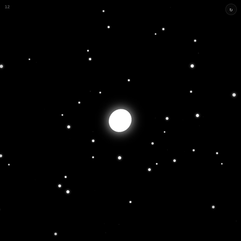

# mote

English · [한국어](README.ko.md)

**A minimalist arcade game where you start as a single point of light and grow by absorbing smaller things.**

**[▶ Play in the browser](https://tinkerer0.github.io/mote_game/)**



You absorb food and cells smaller than you and avoid larger cells. As you grow, the screen zooms out and a bigger world appears, and the color of the world changes at certain sizes. You can trade your current size for coins and start over, and use the coins to collect skins for the player, the food, and the background.

Move with the mouse, touch, or the arrow keys (WASD). Enter trades your current size for coins, M toggles the background music, and R restarts after a game over. The in-game text is in Korean.

## Run it yourself

It is a single HTML file, with no build step and no external libraries.

```sh
git clone https://github.com/tinkerer0/mote_game.git
cd mote_game
python3 -m http.server 8000   # open http://localhost:8000
```

Coins and skins are saved only in this browser (`localStorage`).

## Feedback

I am new to this field and there is a lot I still get wrong. If you see something to fix or something I should know, an issue or PR would be very much appreciated.

## License

[MIT](LICENSE)
